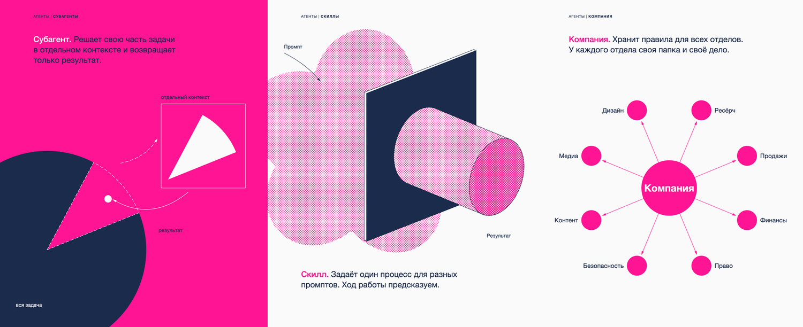

# visual-grammar — одна мысль на листе простыми формами

Agent skill for Claude Code and Codex: turns one idea into a geometric illustration sheet (SVG and PNG) or a looping motion explainer, using the principles of Christian Leborg's *Visual Grammar*.



Скилл учит агента рисовать мысль отношением форм: что на что давит, что вокруг чего вращается, что что вытесняет. Лист собирается кодом (Python, SVG), проверяется автоматически на наезды, края и контраст, а потом «слепым чтением»: субагент без контекста смотрит на лист без подписей и пересказывает, что на нём происходит. Не совпало с задуманным — композицию меняют.

## Что внутри

| Путь | Что это |
|---|---|
| `SKILL.md` | инструкция агенту: от мысли до проверенного листа и ролика |
| `GRAMMAR.md` | словарь из 66 терминов: определение и какую мысль несёт |
| `scripts/vg.py` | рисование листа: формы, линии, текст, палитры |
| `scripts/render.py` | проверка листа и PNG |
| `scripts/motion.py` | зацикленный ролик без шва |
| `examples/` | образцы листов, азбука из 66 фигур, серия, роликов-петель |

## Установка

Нужны Python 3 и Chrome (для PNG). Для роликов ещё `npx hyperframes`, `ffmpeg`, `magick`.

```bash
git clone https://github.com/serejaris/visual-grammar.git
cp -R visual-grammar ~/.claude/skills/visual-grammar      # Claude Code
cp -R visual-grammar .agents/skills/visual-grammar        # Codex, внутри проекта
```

Проверка:

```bash
python3 examples/plates.py /tmp/vg mono
python3 scripts/render.py /tmp/vg/*.svg
```

## Как вызвать

Скажите агенту: «нарисуй мысль формами в стиле Visual Grammar: субагент решает часть задачи отдельно». Ещё работают «геометрическая иллюстрация», «обложка из кругов», «моушн-объяснялка», «идеальный луп».

## Об источнике и лицензии

Скилл вдохновлён книгой Christian Leborg, *Visual Grammar* (Princeton Architectural Press, 2006). Текст и иллюстрации книги в репозиторий не входят, определения в `GRAMMAR.md` написаны своими словами. Проект не связан с автором и издательством. Купите книгу, она хороша.

Код и тексты скилла — MIT, см. `LICENSE`.
